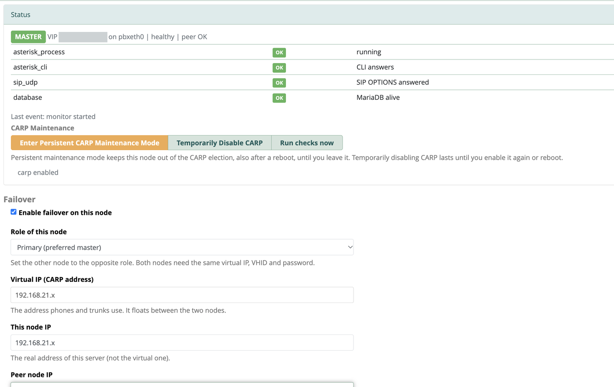
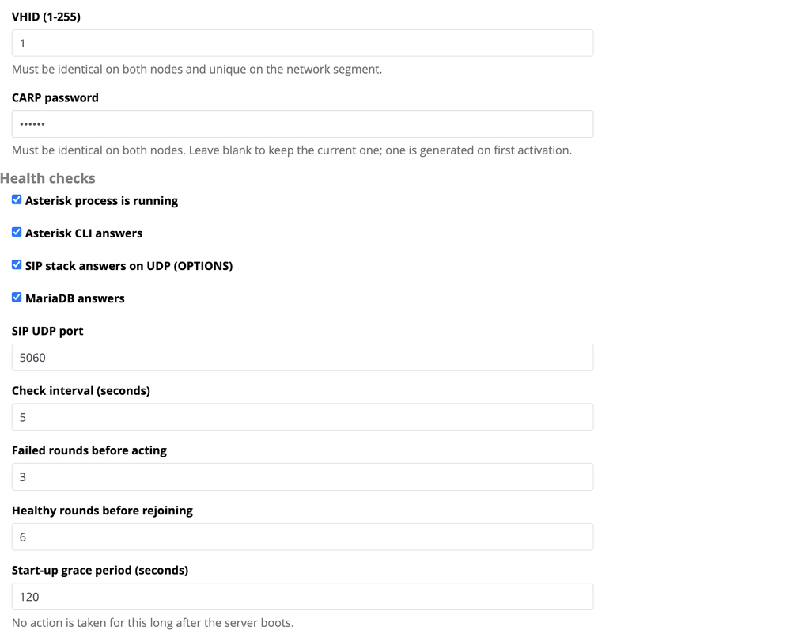
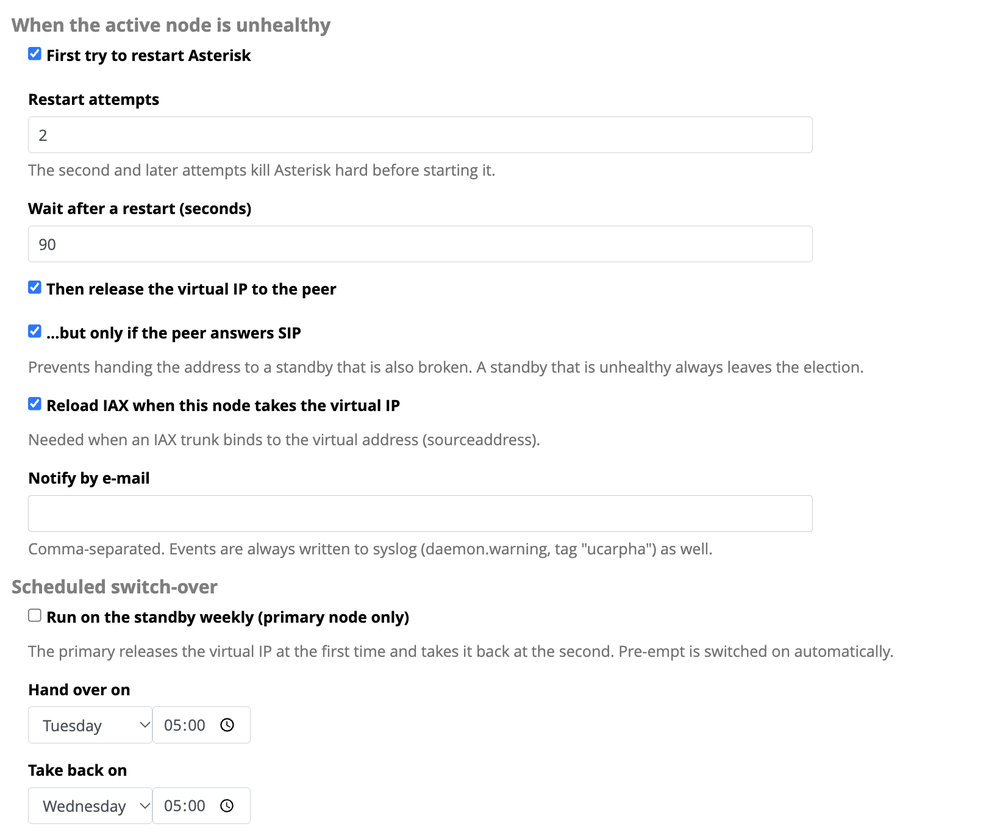

# ucarpha — CARP high availability for FreePBX 17

**English** · [Українська](README.uk.md)

Downloads for **ucarpha**, a FreePBX 17 module that keeps a floating virtual IP between two stations with
[ucarp](https://github.com/jedisct1/UCarp), checks Asterisk health and fails over automatically.

**Download:** [latest release](../../releases/latest) — `ucarpha-<version>.tgz` (Module Admin archive) and an optional `.deb`.
Checksums are in `SHA256SUMS`.

> **Status: experimental.** Tested on a two-node lab of FreePBX 17.0.33 (Debian 12). The module is unsigned and includes
> root helpers that manage network addresses and services. Try it on a test pair before production.

## What it does
Phones and trunks talk to one **virtual IP (VIP)**. Exactly one node — the MASTER — holds it. If the MASTER stops being
healthy, the VIP moves to the other node, so calls keep working without reconfiguring anything.

- **Health checks** on every node: Asterisk process, Asterisk CLI, SIP (OPTIONS over UDP) and MariaDB.
- **Self-healing first:** an unhealthy MASTER restarts Asterisk (the second attempt is a hard kill and start). Only if
  that fails, it hands the VIP to the peer — and only if the peer answers SIP, so the VIP never goes to a dead node.
- **A sick standby cannot take over:** it leaves the CARP election and rejoins after several healthy checks.
- **CARP Maintenance, pfSense style:** *Enter / Leave Persistent CARP Maintenance Mode* (survives reboot) and
  *Temporarily Disable CARP / Enable CARP* (until re-enabled or reboot), for planned work on a node.
- **Schedule:** hand the VIP over on a day/time and take it back later (for example Tuesday 05:00 → Wednesday 05:00).
- **Notifications:** syslog and e-mail; a live status JSON for Zabbix.
- **Guided setup page** with an in-page **Help**: it tells you what is still missing (ucarp, root helpers, firewall
  addresses) and how to remove everything. Nothing is installed or changed as root automatically.

Configuration is **not synchronised** between the nodes (extensions, trunks and so on are yours to keep identical).

## Screenshots
**Status and CARP Maintenance** — live node state, the four health checks and the pfSense-style maintenance buttons:

**Health checks** and thresholds:

**Actions when the active node is unhealthy**, notifications and the scheduled switch-over:

## Install (on every node)
1. Download `ucarpha-<version>.tgz` and upload it in **Admin → Module Admin → Upload**, then install.
   The module is unsigned; if it is refused run `fwconsole setting SIGNATURECHECK 0` as root.
2. Open **Admin → CARP High Availability**. The page lists the steps still missing and links to the firewall:
   - `apt-get install ucarp` (as root);
   - once, as root: `sh /var/www/html/admin/modules/ucarpha/bin/setup-root.sh` (repeat after every module update);
   - add this node, the other node and the VIP to the firewall *Trusted* zone.
3. Enter the VIP, this node's IP, the peer IP, VHID, password and role, then Save. On the second node use the opposite
   role and the same VIP, VHID and password.

## Requirements
FreePBX 17 on Debian, two nodes in the same L2 segment (CARP uses IP protocol 112), the `ucarp` package.

## License
GPL-3.0-or-later. The archive contains the complete source code of the module.
